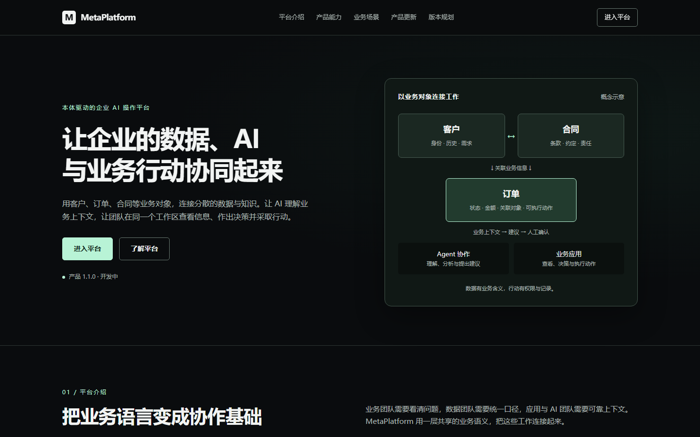
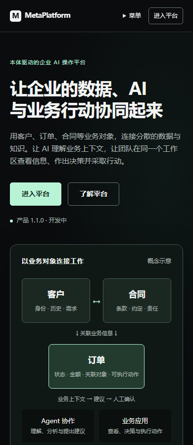

# MetaPlatform 官网产品介绍修订验收

用户 2026-10-11 要求从平台定位和介绍覆盖到更新与版本规划。本次是产品 1.1 开发目标中的官网修订，不等同业务完整链或公开发布。

实现提交：b53d47390a4aa81680ec412267036e8c881743f3；基线：a75583c8b94a4d3c178fad1eb0a76b6408a91c4f。仅修改官网内容源、官网 E2E 和独立部署说明。独立审查：Spec compliant / Quality Approved，Critical 0、Important 0；两个继承 Minor 由集成任务登记。

平台定位为“本体驱动的企业 AI 操作平台”，内容依次介绍业务价值与人群、平台概览、六项能力、订单及示例场景、独立产品更新、1.1.0 / 1.1.1 / 1.2 规划、常见问题和进入平台。产品更新标记开发进展；1.1.0 仍开发中，后续客户端与语义互操作目标不写成已发布。

## 实际验证

- 开发预览：E2E_BASE_URL=http://127.0.0.1:9361 MP11_ARTIFACT_MODE=revision-dev pnpm exec playwright test tests/e2e/website-entry.spec.ts --project=web --reporter=list（工作目录 metaplatform-frontend/apps/web），22 passed，33.1s。
- 构建：pnpm --dir metaplatform-frontend --filter @mate/web build，tsc -b 与 Vite 成功，Vite 35.06s。
- 实际构建预览：相同官网套件，E2E_BASE_URL=http://127.0.0.1:9362、MP11_ARTIFACT_MODE=revision-built，22 passed，8.7s。
- 覆盖 360/390/768/1440、旧锚点、更新与规划导航、键盘/手机菜单、Escape、FAQ、减少动态效果、禁用 JS 默认与配置后入口、匿名 /home → /login、非法 URL 拒绝及文字替换符 URL 回归。未把 Mock 或健康检查当完整业务验收。
- 最终源码、dist、实际开发 HTTP 与构建 HTTP 均为 SHA256 E5DB328BBFA70B034DDE079A0C4AAB93642293AB93FC19007D17AB79F6130785，29096 bytes。

首屏曾拆分“数据”一词，已改为自然短句；移动菜单选择/Escape 收起有失败先行与通过证据。控制器与独立审查均看过最终桌面/手机首屏，完整页面截图用于整体结构检查；不把自动缩小的全页图当作完整对比度审计。

## 最终公开截图

[桌面完整页面](mp11-website-revision/desktop-full.png) · [手机完整页面](mp11-website-revision/mobile-full.png)

这些文件从最终构建截图归档，公开内容不含账户或凭据；不依赖之后会清理的计划临时目录。

## 运行与边界

官网修订审查完成时保留的预览为9361/PID58796与9200/PID52012；这两个进程之后外部结束，不能当作当前监听或连续运行证据。构建预览9362/PID9172已按记录身份清理。2026-10-12已按用户启动请求恢复当前源码预览：[官网9200](http://127.0.0.1:9200/website/#top)，Node/Vite PID51708；独立官网9361/PID59928。实际HTTP均200、29096 bytes，内容与上述验收SHA一致。Docker底层WSL无响应后普通Desktop重启已恢复网关/登录与30个平台健康容器；后端原有镜像和数据保留，1.1完整签名登录/业务联调仍由任务8验收。

既有 Vite 大包警告与 NO_COLOR/FORCE_COLOR 冲突告警仍存在，集成任务处理或明确保留。真实签名账户登录、订单应用完整链、MCP 兼容、正式域名部署、连续试运行和用户试用不在本次已通过结果中。官网唯一内容源仍为 metaplatform-frontend/apps/web/public/website/index.html；默认 /home 和安全配置 helper 保持原认证接线。
